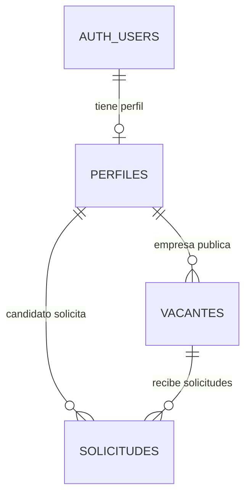
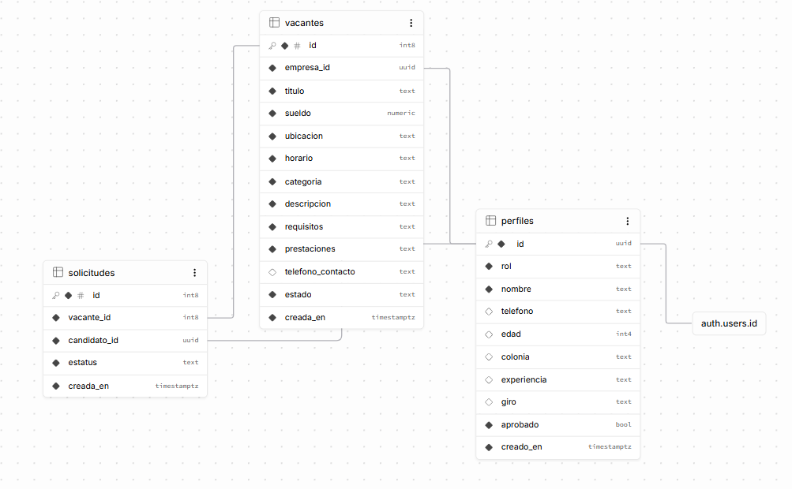
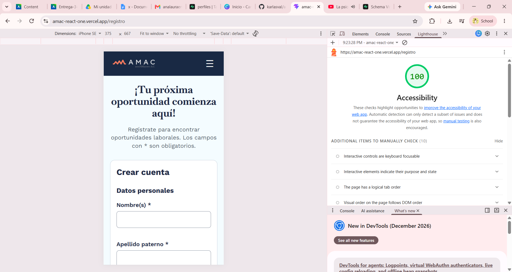

# AMAC — Bolsa de trabajo para personas adultas mayores

**Proyecto final de Desarrollo de Aplicaciones Web · Universidad de Monterrey (UDEM) · Otoño 2026**  
**Entrega 3: React, Supabase y Vercel**

AMAC es una plataforma web que busca facilitar el acceso de personas adultas mayores a oportunidades de empleo y ayudar a las empresas a publicar vacantes y administrar postulaciones. El proyecto comenzó con un prototipo en Figma, continuó con una maquetación en HTML y CSS (Entrega 2) y evolucionó a una aplicación desarrollada con React y conectada a una base de datos real en Supabase.

- **Aplicación publicada:** https://amac-react-one.vercel.app/
- **Repositorio de esta entrega:** https://github.com/analauraencinasp-eng/amac-react
- **Versión anterior (HTML y CSS):** https://amac-web-weld.vercel.app/
- **Repositorio de la Entrega 2:** https://github.com/karlasval/amac-web

## 1. Integrantes y distribución del trabajo

Se mantuvo la distribución de responsabilidades de la Entrega 2, adaptando las mismas áreas a la versión de React. El desarrollo se organizó por módulos para conservar el diseño anterior e integrarlo con las funciones de la aplicación.

| Integrante | Responsabilidades en el proyecto |
|---|---|
| **Karla Sofia Valdovinos Borbón** | Organización general y continuidad del diseño visual; estilos compartidos y componentes de encabezado y pie; módulo de empresas para administrar vacantes y revisar solicitudes, incluyendo las vistas `EmpresaVacantes`, `PublicarVacante` y `SolicitudesRecibidas`; documentación del proyecto y apoyo en la preparación de su publicación. |
| **Ana Laura Encinas Pablos** | Módulo del candidato y navegación por vacantes; vistas de listado, detalle y seguimiento de solicitudes, incluyendo `ListadoVacantes`, `DetalleVacante` y `MisSolicitudes`; integración de las pantallas correspondientes con componentes reutilizables, React y consultas a Supabase. |
| **José Luis Garza** | Módulo de acceso y registro; formularios de inicio de sesión, registro de candidato y registro de empresa, incluyendo `Login`, `RegistroCandidato` y `RegistroEmpresa`; validaciones, autenticación y conexión de estos flujos con Supabase Auth. |

La integración final reúne los módulos en una sola aplicación con React Router, Context y Supabase. **La distribución de funciones no sustituye la evidencia de commits individuales en GitHub**, que debe revisarse antes de entregar.

## 2. Tecnologías utilizadas

| Tecnología | Uso en AMAC |
|---|---|
| **React** | Componentes y vistas de la aplicación. |
| **Vite** | Entorno de desarrollo y compilación del frontend. |
| **JavaScript y JSX** | Lógica de la aplicación e interfaces. |
| **React Router** | Navegación y rutas protegidas según el rol. |
| **HTML y CSS** | Estructura visual y estilos responsivos reutilizados de la Entrega 2. |
| **Supabase Auth** | Registro, inicio y cierre de sesión. |
| **PostgreSQL (Supabase)** | Almacenamiento de perfiles, vacantes y solicitudes. |
| **Row Level Security (RLS)** | Restricción del acceso a los datos según el usuario y su rol. |
| **Git y GitHub** | Control de versiones y repositorio remoto. |
| **Vercel** | Publicación del frontend mediante HTTPS. |

## 3. Funcionalidades de la aplicación

### Candidato

- Consultar vacantes activas obtenidas desde Supabase.
- Buscar por título o ubicación y filtrar por categoría y horario.
- Ver los datos completos de una vacante y la opción **Llamar** cuando existe teléfono de contacto.
- Registrarse con nombre, correo, contraseña, teléfono, edad, colonia y experiencia, aceptando términos y condiciones.
- Iniciar y cerrar sesión.
- Postularse a vacantes **solo después de la aprobación por AMAC**.
- Impedir una segunda postulación a la misma vacante.
- Consultar solicitudes con su fecha, empresa y estatus.
- Cancelar solicitudes todavía pendientes, con confirmación previa; no cancelar solicitudes aceptadas o rechazadas.

### Empresa

- Registrar una cuenta de empresa con sus datos básicos.
- Publicar vacantes con título, sueldo, ubicación, categoría, horario, descripción, requisitos y prestaciones.
- Agregar un teléfono de contacto opcional cuando recibe postulaciones por ese medio.
- Consultar sus propias vacantes y el número de solicitudes recibidas.
- Pausar, reactivar o cerrar vacantes.
- Consultar datos de los candidatos que se postularon a sus vacantes.
- Actualizar el estatus de solicitudes a **En revisión**, **Aceptada** o **Rechazada**, según las reglas aplicables.

### AMAC y seguridad

- El equipo representa a AMAC al aprobar candidatos desde **Supabase → Table Editor → perfiles**, cambiando el campo `aprobado` a `true`.
- Las páginas privadas están protegidas por rol desde React Router.
- Las políticas RLS de PostgreSQL aplican las restricciones de datos incluso si alguien intenta realizar peticiones directamente desde el navegador.

## 4. Estructura del proyecto

```text
amac-react/
├── public/
│   └── assets/                     # Imágenes y elementos de la interfaz
├── src/
│   ├── main.jsx                    # Punto de entrada, BrowserRouter y AuthProvider
│   ├── App.jsx                     # Rutas de la aplicación
│   ├── App.css
│   ├── index.css
│   ├── components/
│   │   ├── Encabezado.jsx
│   │   ├── Pie.jsx
│   │   ├── TarjetaVacante.jsx
│   │   ├── DatosVacante.jsx
│   │   ├── EtiquetaEstatus.jsx
│   │   └── RutaProtegida.jsx
│   ├── context/
│   │   └── AuthContext.jsx         # Sesión, perfil y estado de carga
│   ├── lib/
│   │   └── supabase.js             # Cliente de Supabase
│   ├── pages/
│   │   ├── ListadoVacantes.jsx
│   │   ├── DetalleVacante.jsx
│   │   ├── Login.jsx
│   │   ├── RegistroCandidato.jsx
│   │   ├── RegistroEmpresa.jsx
│   │   ├── MisSolicitudes.jsx
│   │   ├── EmpresaVacantes.jsx
│   │   ├── PublicarVacante.jsx
│   │   └── SolicitudesRecibidas.jsx
│   └── styles/
│       └── styles.css
├── supabase/
│   └── esquema.sql                 # Tablas, funciones, permisos y políticas RLS
├── .gitignore
├── package.json
├── vercel.json                    # Reescritura de rutas para la SPA
└── README.md
```

## 5. Instalación y ejecución local

**Requisito:** Node.js 20 o superior y acceso al proyecto de Supabase correspondiente.

1. Clonar el repositorio y entrar a la carpeta:

   ```bash
   git clone https://github.com/analauraencinasp-eng/amac-react.git
   cd amac-react
   ```

2. Instalar las dependencias:

   ```bash
   npm install
   ```

3. Crear un archivo **`.env.local`** en la raíz del proyecto con los valores del proyecto de Supabase:

   ```env
   VITE_SUPABASE_URL=URL_DEL_PROYECTO
   VITE_SUPABASE_PUBLISHABLE_KEY=LLAVE_PUBLICA_DEL_PROYECTO
   ```

4. Ejecutar la aplicación:

   ```bash
   npm run dev
   ```

5. Abrir la URL local que indique Vite (normalmente `http://localhost:5173`).

Para generar los archivos de producción:

```bash
npm run build
```

**Seguridad:** el archivo `.env.local` está excluido de Git mediante `*.local`. Nunca se deben subir la contraseña de la base de datos ni las llaves `secret` o `service_role`. Las variables `VITE_` son visibles en el frontend, por lo que únicamente se utiliza ahí la llave pública.

## 6. Base de datos PostgreSQL

La base de datos se encuentra en Supabase y utiliza tres tablas principales:

| Tabla | Qué almacena | Relación principal |
|---|---|---|
| **perfiles** | Nombre, rol (`candidato`, `empresa` o `admin`), teléfono, edad, colonia, experiencia, giro y aprobación. | `id` referencia a `auth.users(id)`. |
| **vacantes** | Empresa, título, sueldo, ubicación, horario, categoría, descripción, requisitos, prestaciones, teléfono y estado. | `empresa_id` referencia a `perfiles(id)`. |
| **solicitudes** | Candidato, vacante, estatus y fecha de postulación. | `vacante_id` referencia a `vacantes(id)` y `candidato_id` a `perfiles(id)`. |

Diagrama de relaciones simplificado:



**Captura del diagrama de Supabase (pendiente de adjuntar):** guardar la captura de **Database → Schema Visualizer** en `docs/schema-visualizer.png` y colocarla aquí con:

```md

```

La captura debe mostrar las tres tablas y las relaciones entre ellas.

### Restricciones importantes

- **PRIMARY KEY:** identifica cada registro.
- **FOREIGN KEY:** mantiene las relaciones entre usuarios, vacantes y solicitudes.
- **NOT NULL y CHECK:** validan campos obligatorios y valores permitidos.
- **UNIQUE (vacante_id, candidato_id):** evita dos postulaciones del mismo candidato a una vacante; el error PostgreSQL **23505** corresponde a una violación de unicidad.
- **ON DELETE CASCADE:** elimina los registros relacionados correspondientes cuando desaparece el registro del que dependen.
- **Trigger `al_crear_usuario`:** crea automáticamente un perfil cuando se registra una cuenta mediante Supabase Auth.

El SQL final del proyecto está incluido en **[`supabase/esquema.sql`](supabase/esquema.sql)**.

## 7. Seguridad y políticas RLS

Las políticas **Row Level Security** están definidas en `supabase/esquema.sql` para las tres tablas. Su propósito es evitar que un usuario acceda o modifique información que no le corresponde.

| Tabla | Política RLS | Explicación |
|---|---|---|
| perfiles | Cada quien ve su perfil | Cada usuario puede consultar su propio registro. |
| perfiles | Todos ven los perfiles de empresas | Permite consultar los perfiles cuyo rol es empresa. |
| perfiles | La empresa ve a quien aplicó a sus vacantes | Una empresa puede consultar el perfil de quien se postuló a una de sus vacantes. |
| perfiles | Cada quien edita su perfil | El usuario solo puede editar su registro, dentro de las columnas autorizadas. |
| vacantes | Ver vacantes activas o las propias | Se pueden consultar las vacantes activas; cada empresa puede consultar las suyas. |
| vacantes | El candidato sigue viendo las vacantes a las que aplicó | Un candidato puede consultar la vacante asociada a su solicitud aunque se pause. |
| vacantes | Solo empresas publican, a su nombre | Únicamente un perfil de empresa puede insertar vacantes con su propio identificador. |
| vacantes | La empresa edita sus vacantes | Una empresa solo puede modificar sus propias vacantes. |
| solicitudes | Candidato ve las suyas; empresa ve las de sus vacantes | Cada candidato ve sus solicitudes; la empresa ve las recibidas por sus vacantes. |
| solicitudes | Solo candidatos aprobados se postulan | Solo los candidatos aprobados pueden insertar una solicitud propia con estatus inicial Enviada. |
| solicitudes | Candidato cancela si no está resuelta | Un candidato puede cambiar a Cancelada una solicitud Enviada o En revisión. |
| solicitudes | Empresa cambia el estatus | La empresa puede cambiar el estatus de solicitudes de sus vacantes, dentro de las opciones permitidas. |

Además:

- Los permisos **GRANT** controlan las operaciones SQL generales; las políticas RLS restringen las filas.
- El candidato no puede aprobarse a sí mismo, porque la columna `aprobado` no está habilitada para actualización desde su cuenta.
- La autenticación y las contraseñas son administradas por **Supabase Auth**.
- Las rutas protegidas en React mejoran la navegación, pero la **protección real de los datos** ocurre en PostgreSQL mediante RLS.

## 8. Requerimientos funcionales implementados

El siguiente estado refleja **funcionalidades presentes en el código entregado**. Antes de darlo por definitivo, el equipo debe comprobar que funcionen en Vercel con cuentas y registros reales.

| Requerimiento | Funcionalidad | Estado según el código |
|---|---|---|
| RF-001 | Listado de vacantes activas desde la base de datos | ✅ Completo en código* |
| RF-002, RF-007 | Búsqueda por título/ubicación, filtros y mensaje sin resultados | ✅ Completo en código* |
| RF-003, RF-051 | Detalle de vacante y botón Llamar condicionado a la existencia de teléfono | ✅ Completo en código* |
| RF-011, RF-012, RF-013 | Registro de candidato y aceptación de términos | ✅ Completo en código* |
| RF-008, RF-009 | Inicio y cierre de sesión | ✅ Completo en código* |
| RF-004, RF-054 | Postulación de candidatos aprobados, bloqueo de duplicados y confirmación | ✅ Completo en código* |
| RF-005, RF-006 | Mis solicitudes, estatus y cancelación con confirmación | ✅ Completo en código* |
| RF-015 | Registro simplificado de empresa | ✅ Completo en código* |
| RF-019 | Publicar vacantes y solicitar teléfono opcional | ✅ Completo en código* |
| RF-020, RF-021 | Panel de vacantes de la empresa, conteos, pausar/reactivar/cerrar | ✅ Completo en código* |
| RF-022, RF-024 | Solicitudes recibidas y cambio de estatus por la empresa | ✅ Completo en código* |
| RF-010 | Restricción de rutas según rol y políticas RLS | ✅ Completo en código* |

*El estado se refiere a las funciones presentes en el repositorio revisado. Deben verificar cada flujo en la URL pública de Vercel antes de marcar como completadas las pruebas de funcionamiento.*

**Funcionalidades opcionales no incluidas como pantallas en el código revisado:** panel de administrador para aprobar candidatos, edición de perfil desde la aplicación, carga de logo de empresa con Supabase Storage, vacantes favoritas y recuperación de contraseña. La aprobación se realiza desde el Table Editor de Supabase, como permite la Entrega 3.

## 9. Accesibilidad y diseño responsivo

El proyecto conserva las decisiones de diseño de la entrega anterior:

- HTML semántico y formularios con etiquetas visibles.
- Texto base de aproximadamente **18 px**.
- Diseño responsivo para celular y escritorio mediante CSS.
- Estados de carga, avisos y mensajes de error visibles para el usuario.
- Indicadores de foco para navegar mediante teclado.
- Separación de elementos visuales en componentes reutilizables.

El diseño anterior utilizó la paleta principal **azul oscuro `#192944`**, **coral `#ff815c`** y fondos claros, así como las fuentes **Baskervville** y **Work Sans**. Estos elementos sirvieron como base visual para la versión actual.

**Prueba Lighthouse de la versión React (pendiente):** ejecutar la auditoría de **Accessibility en Mobile** sobre la URL de Vercel, registrar la puntuación real (meta: al menos 90) y guardar una captura en `docs/lighthouse-react.png`. Cuando esté disponible, insertarla aquí con:

```md

```

La Entrega 2 obtuvo 100/100, pero esta calificación no se debe presentar como si perteneciera automáticamente a la Entrega 3. También debe comprobarse el diseño en un teléfono.

## 10. Despliegue en Vercel

El repositorio de GitHub está conectado con el proyecto de Vercel. El proceso de despliegue utiliza:

1. Código y cambios registrados en GitHub.
2. Compilación de Vite mediante `npm run build`.
3. Publicación de los archivos de `dist`.
4. Variables `VITE_SUPABASE_URL` y `VITE_SUPABASE_PUBLISHABLE_KEY` configuradas en Vercel.
5. HTTPS para el acceso público.

El archivo **[`vercel.json`](vercel.json)** contiene una regla de *rewrite* hacia `index.html` para permitir que las rutas internas de React Router funcionen al recargarse directamente.

**URL del proyecto:** https://amac-react-one.vercel.app/

## 11. Cuentas de prueba

Estas cuentas son **exclusivamente para la evaluación académica** y deben utilizarse con datos ficticios, sin información personal o sensible.

| Cuenta de prueba | Rol | Correo | Contraseña | Aprobación |
|---|---|---|---|---|
| Regina | Candidato | `correo_regina@correo.com` | `123456` | **Aprobada** |
| Mario | Candidato | `correo_mario@correo.com` | `123456` | **No aprobado** |
| Empresa 1 | Empresa | `correo_empresa@correo.com` | `123456` | No aplica |
| Empresa 2 | Empresa | `correo_empresa2@correo.com` | `123456` | No aplica |

Para probar la restricción de aprobación se necesita **al menos un candidato aprobado y uno no aprobado**. El estado puede comprobarse en **Supabase → Table Editor → perfiles → aprobado**.

**Advertencia:** `123456` es una contraseña débil utilizada únicamente para cuentas de demostración. No debe reutilizarse para cuentas personales ni administrativas. Tras la evaluación, conviene cambiarla o desactivar estas cuentas.

## 12. Evidencias de la entrega final

- Repositorio GitHub con la participación individual registrada mediante commits de los tres integrantes (**pendiente de verificar en el historial**).
- URL pública de Vercel funcionando, con un mínimo de seis vacantes de ejemplo.
- Cuentas de prueba indicadas en este README.
- Archivo `supabase/esquema.sql` con el esquema final de la base de datos.
- Captura del **Schema Visualizer** de Supabase en `docs/schema-visualizer.png` (**por agregar**).
- Auditoría Lighthouse de accesibilidad en React y captura en `docs/lighthouse-react.png` (**por agregar**), más revisión responsiva.
- Video de presentación de **12 a 15 minutos**, con participación en cámara de los tres integrantes, demo del candidato y la empresa, y explicación de React, Supabase, seguridad y despliegue.
- Enlace al video y a las diapositivas utilizadas.

**Video:** [PENDIENTE: agregar el enlace público o no listado al video final]  
**Diapositivas:** [PENDIENTE: agregar enlace o PDF a la presentación de apoyo; el proyecto solicita su entrega]

---

**Universidad de Monterrey · Desarrollo de Aplicaciones Web · Proyecto AMAC · Entrega 3 · OT2026**
