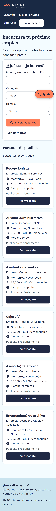
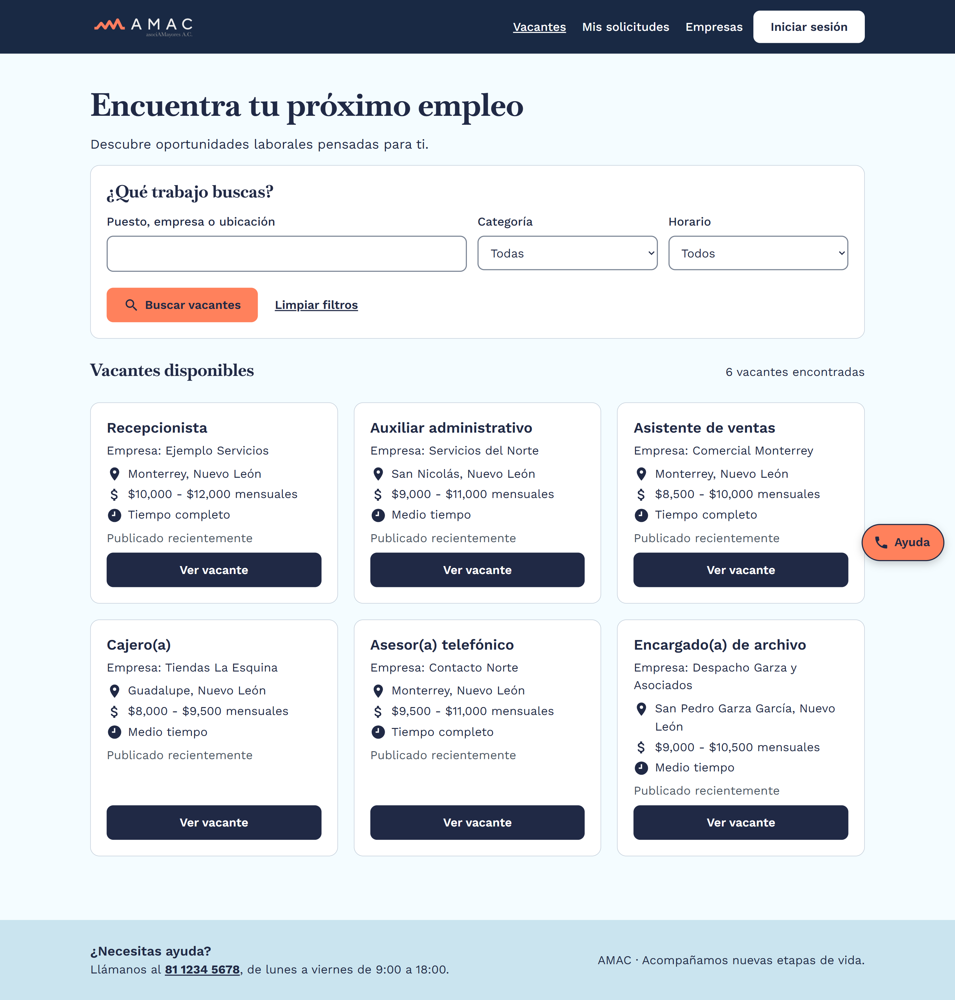
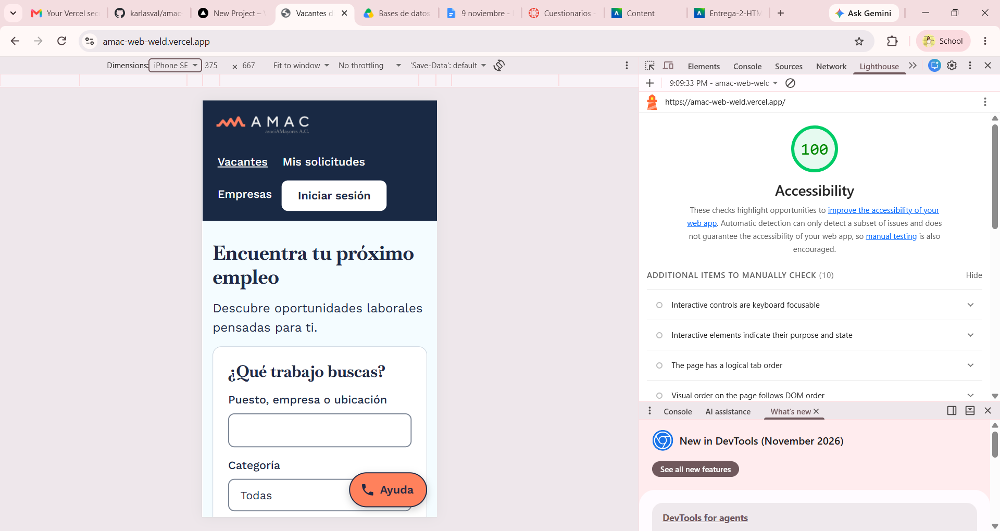

# AMAC – Bolsa de trabajo para adultos mayores

Proyecto final de **Desarrollo de Aplicaciones Web · UDEM · OT2026**  
**Entrega 2: Maquetación en HTML y CSS**

Este proyecto consiste en la maquetación de la plataforma de empleo AMAC, diseñada para facilitar que las personas adultas mayores encuentren oportunidades laborales. Las páginas se basan en nuestro prototipo de Figma y están desarrolladas con HTML semántico y CSS responsivo, considerando la accesibilidad y la facilidad de uso.

**Sitio publicado en Vercel:** https://amac-web-weld.vercel.app/

## Integrantes y distribución del trabajo

| Integrante | Responsabilidades |
|---|---|
| **Karla Sofia Valdovinos Borbón (Persona 1)** | Estructura inicial del proyecto; archivos CSS compartidos (`variables.css`, `base.css`, `layout.css` y `componentes.css`); encabezado y pie de página; `empresa-vacantes.html`, `solicitudes-recibidas.html` y `404.html`; README y coordinación de publicación en Vercel. |
| **Ana Laura Encinas Pablos (Persona 2)** | `index.html`, `vacante.html`, `confirmacion.html` y `mis-solicitudes.html`. |
| **José Luis Garza (Persona 3)** | `login.html`, `registro-candidato.html` y `registro-empresa.html`. |

Cada integrante subirá sus archivos mediante commits desde su cuenta de GitHub. Los cambios se integrarán al repositorio mediante ramas y Pull Requests.

## Páginas del sitio

### Páginas obligatorias

| Archivo | Pantalla | Requerimientos |
|---|---|---|
| `index.html` | Listado de vacantes, búsqueda visual, filtros y tarjetas | RF-001, RF-002, RF-007 |
| `vacante.html` | Información del empleo, botón Postularme y opción Llamar | RF-003, RF-004, RF-051 |
| `login.html` | Inicio de sesión | RF-008 |
| `registro-candidato.html` | Registro de candidato | RF-011, RF-012, RF-013 |
| `mis-solicitudes.html` | Solicitudes enviadas y estatus | RF-005, RF-006 |
| `empresa-vacantes.html` | Panel de vacantes de una empresa | RF-020, RF-021 |

### Páginas adicionales

| Archivo | Pantalla |
|---|---|
| `confirmacion.html` | Confirmación de postulación |
| `registro-empresa.html` | Registro de empresa |
| `solicitudes-recibidas.html` | Candidatos que se postularon a una empresa |
| `404.html` | Página de error |

## Flujo de navegación para la demostración

`index.html` → `vacante.html` → botón **Postularme** → `confirmacion.html` → **Ver mis solicitudes** → `mis-solicitudes.html`.

Esta es una **entrega estática**: los datos están escritos directamente en HTML. Los botones y filtros que solo representan acciones se incluyen como elementos visuales; los enlaces entre páginas sí permiten recorrer el sitio. La implementación con React y datos reales corresponde a una entrega posterior.

## Estructura del proyecto

```text
amac-web/
├── index.html
├── vacante.html
├── login.html
├── registro-candidato.html
├── mis-solicitudes.html
├── empresa-vacantes.html
├── confirmacion.html
├── registro-empresa.html
├── solicitudes-recibidas.html
├── 404.html
├── css/
│   ├── variables.css
│   ├── base.css
│   ├── layout.css
│   └── componentes.css
├── img/
│   └── logo-amac.svg
└── README.md
```

## Paleta de colores

Los colores se organizan en `css/variables.css` para poder reutilizarlos en todas las páginas.

| Variable CSS | Color | Uso |
|---|---|---|
| `--color-encabezado` | `#192944` | Encabezado y paneles oscuros |
| `--color-primario` | `#202945` | Texto y botones principales |
| `--color-acento` | `#ff815c` | Botones y detalles destacados |
| `--color-fondo` | `#f4fcff` | Fondo de página |
| `--color-suave` | `#cae4ef` | Fondos secundarios y pie de página |
| `--color-superficie` | `#ffffff` | Tarjetas y formularios |
| `--color-borde` | `#c3ceda` | Bordes de componentes |

## Tipografías y tamaños

- **Baskervville** para los títulos.
- **Work Sans** para párrafos, menús, formularios y botones.
- Texto base definido en `1.125rem` (18 px).
- Encabezados principales adaptados para celular y escritorio mediante estilos responsivos.

## Componentes reutilizables

Los estilos compartidos permiten reutilizar los mismos elementos en diferentes páginas. Entre los principales componentes identificados están:

| Clase CSS | Componente que representa |
|---|---|
| `.encabezado` y `.navegacion` | Encabezado y menú |
| `.pie` | Pie de página |
| `.boton` | Botones y variantes |
| `.boton-ayuda` | Acceso a ayuda de AMAC |
| `.tarjeta-vacante` | Tarjetas de empleo |
| `.etiqueta-estatus` | Estado de una postulación |
| `.campo-formulario` | Campos con etiqueta |
| `.grupo-campos` | Agrupación de campos |
| `.solicitud` | Tarjeta de solicitud |
| `.vacante-empresa` | Tarjeta de vacante empresarial |
| `.candidato` | Tarjeta de candidato |
| `.metrica` | Resumen numérico |
| `.buscador` | Área de búsqueda |
| `.panel-marca` | Panel informativo de AMAC |

Estos elementos podrán servir como base para componentes de React en la siguiente entrega.

## Accesibilidad y diseño responsivo

El sitio contempla las siguientes decisiones de diseño:

- HTML semántico, con encabezado, navegación, contenido principal y pie de página.
- Texto base de 18 px, utilizando unidades `rem`.
- Formularios con etiquetas visibles.
- Indicadores visuales de foco para navegación con teclado.
- Botones y campos suficientemente grandes para facilitar la interacción.
- Diseño con enfoque **mobile-first**, Flexbox, Grid y media queries.
- Botón de ayuda para contactar a AMAC.

**Verificaciones pendientes antes de entregar:** comprobar contraste mínimo 4.5:1, navegación solo con teclado, zoom al 200 % sin desbordamiento, visualización a 320/768/1024/1440 px, cero errores en el validador W3C y puntuación de Accessibility de al menos 90 en Lighthouse.

## Cómo abrir el sitio

1. Descargar o clonar el repositorio.
2. Abrir la carpeta del proyecto en Visual Studio Code.
3. Abrir `index.html` en el navegador o con Live Server.
4. Utilizar los enlaces de navegación para visitar las demás páginas.

No es necesario instalar React, Bootstrap, Tailwind ni un servidor de base de datos para esta entrega.

## Evidencias de la entrega

### Versión de escritorio (1440 px)



### Versión móvil (375 px)



### Lighthouse - Accessibility

La página principal obtuvo 100/100 en Accessibility
en la evaluación móvil de Lighthouse.



## Publicación

**Repositorio GitHub:** https://github.com/karlasval/amac-web.git  
**Sitio en Vercel:** https://amac-web-weld.vercel.app/

---

**Universidad de Monterrey · Desarrollo de Aplicaciones Web · Entrega 2**
